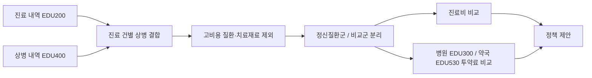

# 정신질환 환자의 의료비 부담과 치료 특성 분석

2025 HIRA 빅데이터 기반 산·학·관 연계 맞춤형 인재양성 교육에서 진행한 팀 프로젝트입니다.

여러 주제 중 **정신건강 관련 이슈와 향후 전망 및 정책 제언**을 선택했고, 팀 **우연**으로 참가해 대상을 받았습니다.

<p align="center">
  
</p>

<p align="center">
  <a href="docs/presentation.pdf">발표자료</a> ·
  <a href="docs/methodology.md">분석 과정</a> ·
  <a href="docs/policy-proposals.md">정책 제안</a>
</p>

## 주제를 정한 이유

정신질환은 한 번의 진료로 끝나기보다 꾸준히 병원을 방문하고 약을 복용해야 하는 경우가 많습니다. 저희 팀은 이 과정에서 환자가 실제로 어느 정도의 비용을 부담하는지, 정신질환이 없는 환자와 비교했을 때 차이가 있는지 궁금했습니다.

처음에는 연령, 질환 종류, 치료 방법 등 여러 방향을 함께 살펴봤습니다. 분석을 진행하면서 정신질환 환자의 진료비와 투약료 차이가 눈에 띄었고, 최종적으로는 **비용 부담을 줄이면서 치료를 꾸준히 이어갈 방법**을 정책으로 제안했습니다.

## 사용한 데이터

HIRA 교육에서 제공한 비식별 데이터를 사용했습니다.

| 데이터 | 사용한 내용 |
|---|---|
| `EDU200` | 환자 및 진료 건 정보, 진료비, 본인부담금 |
| `EDU400` | 주상병·부상병 코드 |
| `EDU300` | 병원에서 발생한 투약 상세 |
| `EDU530` | 약국에서 발생한 투약 상세 |

`EDU200`과 `EDU400`을 환자·진료 건 기준으로 합친 뒤, 상병코드에 정신질환 코드가 있는 환자와 그렇지 않은 환자를 나눴습니다. 암, 파킨슨질환, 크론병, 치료재료대처럼 비용 차이가 큰 항목은 비교에서 제외했습니다.



가공 파일과 변수에 대한 설명은 [data/README.md](data/README.md)에 정리했습니다.

## 다시 확인한 분석 결과

포트폴리오를 만들면서 남아 있는 CSV를 다시 집계했습니다. 발표 당시에는 짧은 기간 안에 여러 분석을 동시에 진행해서 계산 과정과 설명이 충분히 정리되지 못한 부분이 있었습니다. 아래 수치는 현재 보관 중인 최종 CSV를 `scripts/summarize_claims.py`로 다시 계산한 값입니다.

### 진료 건당 본인부담금

| 지표 | 비교군 | 정신질환군 | 차이 |
|---|---:|---:|---:|
| 분석 레코드 수 | 132,888 | 8,103 | - |
| 건당 평균 요양급여비용총액 | 51,168원 | 61,694원 | +20.6% |
| 건당 평균 본인부담금 | 17,753원 | 21,018원 | **+18.4%** |

정신질환군의 건당 평균 본인부담금은 비교군보다 약 3,264원 높았습니다.

### 환자 1인당 투약료

| 구분 | 비교군 | 정신질환군 | 배수 |
|---|---:|---:|---:|
| 병원 | 9,889원 | 22,125원 | **2.24배** |
| 약국 | 7,715원 | 17,896원 | **2.32배** |

비교군의 환자 수가 많아서 전체 투약료 합계는 비교군이 더 컸습니다. 하지만 환자 한 명을 기준으로 보면 병원과 약국 모두 정신질환군의 투약료가 2배 이상 높았습니다.

여기서 투약료는 상세 진료내역의 `AMT`를 환자별로 합한 값입니다. 환자가 직접 낸 본인부담금과 같은 뜻은 아닙니다.

### 발표에서 함께 다룬 내용

발표에서는 비용 외에도 연령대, 정신질환 종류, 치료 방법을 분석했습니다.

- 고령층에서 정신질환 환자 비율이 높아지는 경향
- 정신 및 행동장애, 불면증, 우울증, 공황장애가 많이 나타난 점
- 작업·오락요법과 집단정신치료를 받은 환자의 방문 횟수 차이
- 주요 정신질환 사이의 연관규칙

이 분석들은 당시 발표자료에는 남아 있지만 원 계산 코드는 보관하지 못했습니다. 그래서 README의 대표 수치에는 다시 계산할 수 있는 진료비·투약료 결과만 사용했습니다. 자세한 구분은 [분석 과정](docs/methodology.md)에 적었습니다.

## 제안한 정책

### Win-Win Wellness

진료와 복약을 꾸준히 이어간 환자의 진료비·약제비 부담을 줄여주는 아이디어입니다. 단순히 지원금을 지급하는 것보다 치료 참여와 지원을 연결하면 치료 중단을 줄일 수 있지 않을까 생각했습니다.

### Stay Well, Stay Real

고령층을 대상으로 집단정신치료, 작업·오락요법, 가벼운 운동과 야외 활동을 함께 제공하는 아이디어입니다. 분석 중 고령층의 정신질환 비율과 비약물 치료 방법에 주목하면서 제안했습니다.

두 제안의 발표 당시 내용과 보완할 점은 [정책 제안 문서](docs/policy-proposals.md)에 정리했습니다.

## 아쉬웠던 점

대회 기간이 짧아 전처리 기준과 분석 코드를 체계적으로 남기지 못했습니다. 특히 발표에서 사용한 연령대·치료 유형 분석은 결과 이미지만 남아 있어 지금 완전히 재현하기 어렵습니다.

또한 정신질환군과 비교군의 연령, 성별, 동반질환 차이를 통계적으로 보정하지 않았습니다. 따라서 이 결과는 두 그룹의 차이를 살펴본 탐색적 분석이며, 정신질환이 비용 차이의 직접적인 원인이라고 해석할 수는 없습니다.

이번에 포트폴리오를 정리하면서 남아 있는 데이터로 비용 지표를 다시 계산하고, 재현 가능한 부분과 그렇지 않은 부분을 구분해 기록했습니다.

## 폴더 구성

```text
.
├── README.md
├── assets/                    # 발표 표지와 수상 사진
├── data/README.md             # 데이터 및 가공 파일 설명
├── docs/
│   ├── methodology.md        # 분석 과정과 한계
│   ├── policy-proposals.md   # 발표에서 제안한 정책
│   ├── references.md         # 참고자료
│   └── presentation.pdf      # 최종 발표자료
└── scripts/
    └── summarize_claims.py   # 남아 있는 CSV 재집계 스크립트
```

원본 교육 데이터는 공개하지 않습니다. 원본 프로젝트와 같은 `OK/`, `c/` 폴더가 있는 환경에서는 아래 명령으로 README의 비용 수치를 다시 확인할 수 있습니다.

```bash
python scripts/summarize_claims.py --data-root ..
```

## 수상

<p align="center">
  
</p>

- 2025 HIRA 빅데이터 기반 산·학·관 연계 맞춤형 인재양성 교육
- 2025년 8월 18일 ~ 8월 22일
- 건강보험심사평가원 주최
- **대상 수상**
