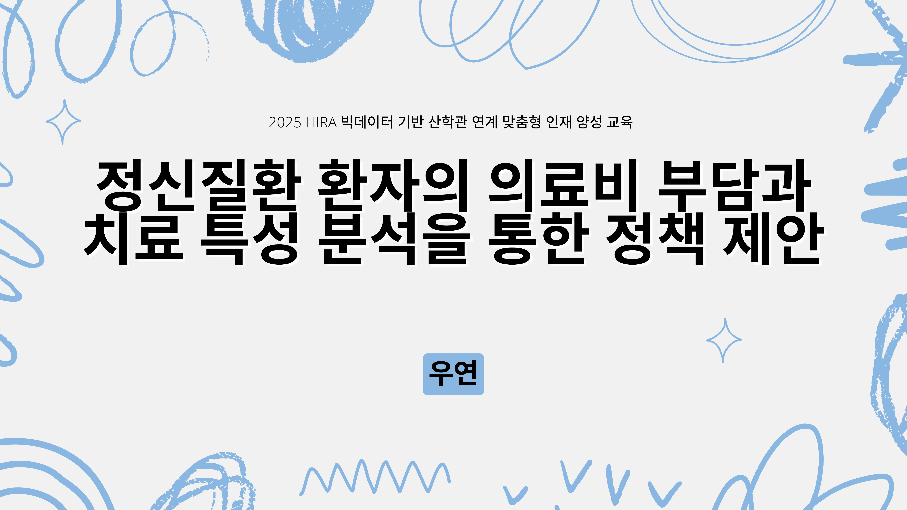
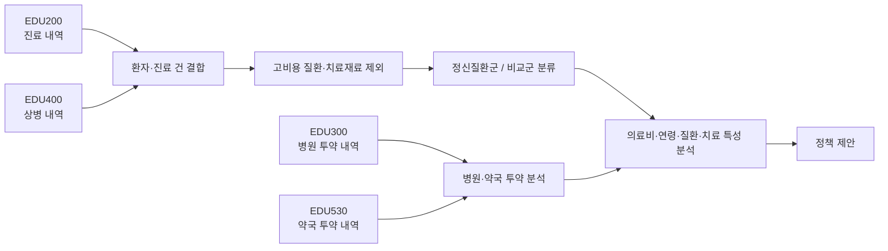
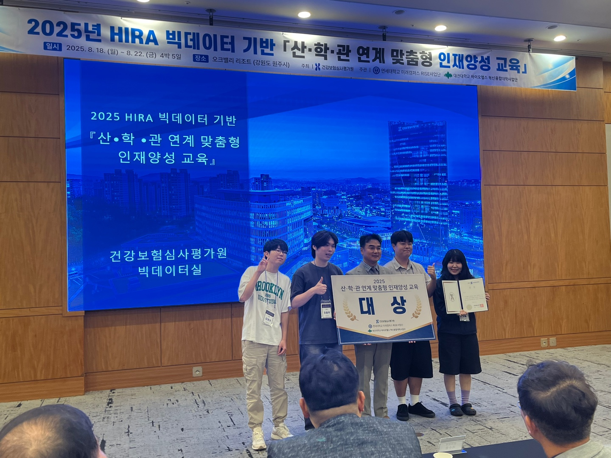

# 정신질환 환자의 의료비 부담과 치료 특성 분석을 통한 정책 제안

> **2025 HIRA 빅데이터 기반 산·학·관 연계 맞춤형 인재양성 교육 대상 수상작**<br>
> 팀 **우연** | 심평원 주제 4: 정신건강 관련 이슈와 향후 전망 및 정책 제언

<p align="center">
  
</p>

<p align="center">
  <a href="docs/presentation.pdf">최종 발표자료</a> ·
  <a href="docs/methodology.md">분석 방법론</a> ·
  <a href="docs/policy-proposals.md">정책 제안</a>
</p>

## 프로젝트 한눈에 보기

| 구분 | 내용 |
|---|---|
| 문제 정의 | 정신질환 환자의 의료비·투약비 부담과 치료 지속성 문제 |
| 분석 목표 | 정신질환 유무에 따른 비용 차이, 연령·질환·치료 특성 분석, 정책 대안 설계 |
| 데이터 | HIRA 교육용 비식별 진료·상병·병원 투약·약국 투약 데이터 |
| 분석 단위 | 환자·진료 건 및 병원/약국 투약 내역 |
| 주요 방법 | 데이터 결합, 질환군 분류, 고비용 교란 요인 제외, 그룹 비교, 연관 분석 |
| 정책 결과물 | **Win-Win Wellness**, **Stay Well, Stay Real** |
| 성과 | 2025 HIRA 산·학·관 연계 맞춤형 인재양성 교육 **대상** |

## 수행 내용과 기술

- HIRA 교육용 SAS·CSV 데이터 구조 파악 및 환자·진료·상병·투약 데이터 결합
- 상병코드 기반 정신질환군 정의와 고비용 교란 요인 제외
- 정신질환군·비교군의 진료비 및 병원·약국 투약료 집계
- Python 기반 시각화, 질환 유형 및 연관규칙 탐색
- 국내외 정책 사례 조사와 두 가지 정신건강 정책 모델 설계
- 분석 결과를 발표자료와 정책 제안으로 전달

## 문제 정의

정신질환은 꾸준한 진료와 복약 관리가 중요하지만, 장기 치료에 따른 비용 부담과 치료 중단 위험이 함께 존재합니다. 이 프로젝트는 교육용 건강보험 청구 데이터를 활용해 다음 질문에 답하고자 했습니다.

1. 정신질환 환자와 비정신질환 환자의 의료비 부담에는 어떤 차이가 있는가?
2. 병원과 약국의 투약비를 환자 단위로 비교하면 어떤 특징이 나타나는가?
3. 연령대, 질환 유형, 치료 유형 분석 결과를 실제 정책으로 어떻게 연결할 수 있는가?

## 분석 흐름



## 핵심 결과

### 1. 정신질환군의 건당 의료비 부담이 더 높았습니다

현재 보관된 최종 CSV를 다시 집계한 결과, 정신질환군의 건당 평균 본인부담금은 **21,018원**으로 비교군 **17,753원**보다 약 **18.4% 높았습니다**. 건당 평균 요양급여비용총액도 정신질환군이 약 **20.6% 높게** 나타났습니다.

| 지표 | 비교군 | 정신질환군 | 차이 |
|---|---:|---:|---:|
| 분석 레코드 수 | 132,888 | 8,103 | - |
| 건당 평균 요양급여비용총액 | 51,168원 | 61,694원 | +20.6% |
| 건당 평균 본인부담금 | 17,753원 | 21,018원 | +18.4% |

### 2. 환자 1인당 투약료는 병원·약국 모두 정신질환군이 2배 이상 높았습니다

| 구분 | 비교군 | 정신질환군 | 정신질환군 / 비교군 |
|---|---:|---:|---:|
| 병원 환자 1인당 투약료 | 9,889원 | 22,125원 | **2.24배** |
| 약국 환자 1인당 투약료 | 7,715원 | 17,896원 | **2.32배** |

전체 투약료는 비교군의 환자 수가 많아 더 컸지만, 환자 한 명당 발생한 투약료는 정신질환군에서 뚜렷하게 높았습니다. 여기서 투약료는 상세 진료내역의 `AMT` 합계이며, 환자가 직접 낸 본인부담금과는 다른 지표입니다.

### 3. 주요 정신질환 유형과 치료 특성을 정책 설계로 연결했습니다

발표자료 기준으로 정신 및 행동장애, 불면증, 우울증, 공황장애가 전체 유형의 **90% 이상**을 차지했습니다. 또한 작업·오락요법 및 집단정신치료가 다른 치료 유형보다 양호한 지표를 보여, 고령층 대상 비약물적 프로그램 제안의 근거로 활용했습니다.

> 비용 지표는 현재 보관된 CSV를 `scripts/summarize_claims.py`로 재집계한 값입니다. 질환 분포·연령·치료 유형 결과는 대회 발표자료에 기록된 결과이며, 원 계산 코드가 남아 있지 않아 별도로 구분했습니다.

> [최종 발표자료](docs/presentation.pdf)는 대회 당시 산출물을 보존한 원본입니다. 발표자료에 포함된 질환 연관성 및 정책 효과 해석은 탐색적 제안이며, 현재 포트폴리오에서는 [방법론 문서](docs/methodology.md)의 한계와 검증 범위를 함께 제시합니다.

## 정책 제안

### Win-Win Wellness

꾸준한 병원 방문과 치료 이행에 따라 진료비·약제비 부담을 단계적으로 낮추는 참여형 지원 정책입니다.

- 환자: 비용 부담 완화와 치료 지속성 향상
- 의료기관: 지속적인 환자 관리와 진료 품질 향상
- 공공부문: 치료 중단·중증화 예방과 장기 사회적 비용 절감

### Stay Well, Stay Real

고령층을 대상으로 집단정신치료, 작업·오락요법, 걷기·스트레칭, 야외 프로그램을 연계하는 예방 중심 정책입니다.

- 복지관과 의료기관의 역할 연계
- 사회적 고립 감소와 비약물적 정신건강 관리
- 우울·불안·불면 등 주요 정신건강 문제의 조기 예방

정책의 운영안과 평가 지표는 [정책 제안 문서](docs/policy-proposals.md)에 정리했습니다.

## 프로젝트 구조

```text
.
├── README.md
├── assets/
│   ├── award-ceremony.jpg
│   └── presentation-cover.png
├── data/
│   └── README.md
├── docs/
│   ├── methodology.md
│   ├── policy-proposals.md
│   ├── references.md
│   └── presentation.pdf
└── scripts/
    └── summarize_claims.py
```

## 재현 가능한 범위

원본 교육 데이터는 데이터 이용 조건과 용량 문제로 저장소에 포함하지 않습니다. 원본 프로젝트 폴더처럼 `OK/`와 `c/` 데이터가 준비되어 있다면 아래 명령으로 핵심 비용 지표를 다시 계산할 수 있습니다.

```bash
python scripts/summarize_claims.py --data-root ..
```

세부 데이터 구조와 파일별 역할은 [데이터 안내](data/README.md), 분석 기준과 한계는 [방법론 문서](docs/methodology.md)를 참고하세요.

## 수상

<p align="center">
  
</p>

- 행사: 2025 HIRA 빅데이터 기반 산·학·관 연계 맞춤형 인재양성 교육
- 기간: 2025년 8월 18일 ~ 8월 22일
- 주최: 건강보험심사평가원
- 수상: **대상**

## 윤리 및 한계

- 본 프로젝트는 비식별 교육용 데이터를 사용했습니다.
- 결과는 관찰 데이터 기반의 탐색적 분석으로, 인과관계를 직접 입증하지 않습니다.
- 고비용 질환과 치료재료를 제외해 비교 가능성을 높였지만, 제외 기준에 따라 결과가 달라질 수 있습니다.
- 실제 정책 도입 전에는 임상 전문가 검토, 형평성 평가, 개인정보 보호, 시범사업 효과 검증이 필요합니다.
